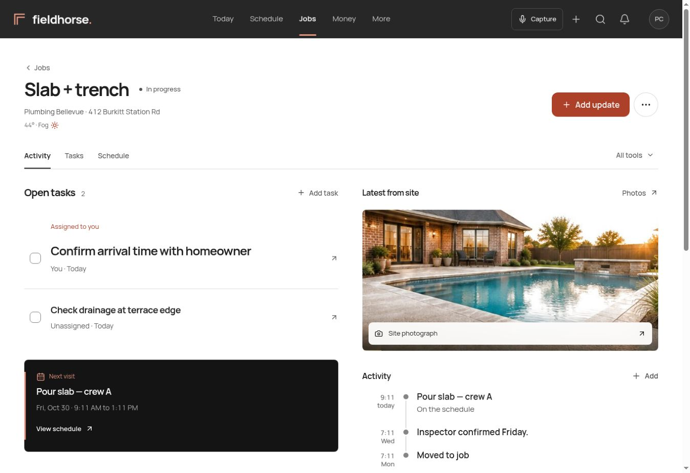

# Workspace 06 implementation

Reviewed October 30, 2026. This is the actual React application adapted to the approved Workspace 06 direction. The separate design prototype is not the production application.

## Result

The job opens with assigned work and the next scheduled visit. Site photography and recent activity provide context alongside that work. On a phone, the same content follows a single column, with customer details in a disclosure and the existing capture and stage actions available at the bottom.

Manrope replaces the previous mixed type families. Neutral white, charcoal, and restrained copper define the hierarchy. The header carries the workspace identity and navigation. Glass is limited to floating controls and the photograph caption. Money summaries use typography and dividing rules rather than nested cards.

## Functional boundaries

- All 18 job sections retain their routes and role filtering: Activity, Daily logs, Milestones, Tasks, Schedule, Inspections, Selections, Materials, Contract balance, Invoices, Expenses, Subcontractors, Change orders, Insurance, Photos, Files, Messages, and Partner access.
- The overview uses existing task records and resilient mutations. Completing a task offers Undo and moves focus to the task heading. Failed task reads show Retry, not an empty job claim.
- The full task editor retains creation, due dates, assignment, completion, deletion, and deletion Undo. Mutations refresh parent job data.
- Photo URLs still come from the existing signed URL query. Failed photos are omitted. The highlighted photo opens Photos and is not repeated in the activity list.
- The next visit is computed from actual schedule records. Remaining history and job tools are accessible through their existing controls.
- Company switching, workspace permissions, search, keyboard shortcuts, capture, billing, and communication handlers remain connected. No database schema, authentication, RLS, or financial calculation changes are included in this iteration.

## Issues found and repaired during review

| Finding | Correction |
| --- | --- |
| Phone task descriptions were squeezed between metadata and small controls | Task text has its own grid column, metadata moves below, controls have targets of at least 44 pixels |
| Legacy section wrappers consumed the phone's usable width | Removed redundant panel borders, shadows, and stacked padding |
| Materials used a fixed six column composer and rows even on a narrow phone | Layout now responds to its container, with labeled inputs and a two column narrow layout |
| Shared font and palette changes could produce a mismatched first paint | Local font preload and matching theme colors; updated the inline script CSP hash |
| Money summaries repeated nested cards | Replaced those frames with rules and made New invoice the primary action |

## Verification

Local TypeScript, ESLint, design audit, RLS audit, production build, and all 1,443 unit tests passed. The browser suite parses 1,516 cases in 50 files, including new regressions for task completion and Undo, task creation after reload, failed task reads, and narrow Materials layouts.

The actual compiled React components were reviewed in the browser using an isolated synthetic data fixture. The fixture and its authentication seed are excluded from Git and production builds. No review mutations were sent to a real Supabase project.

Browser review covered:

- All 18 job sections at 320 pixels, inspecting element bounds rather than relying only on document scroll width. Materials initially failed this check; the repaired composer has its rightmost control at 268 pixels inside a 305 pixel content viewport, with 50 pixel control heights.
- The job overview at 390, 1024, and desktop width. The tablet check found no elements beyond the content boundary.
- Task completion, focus recovery, Undo, reopening, creation, and reload persistence against the controlled stateful fixture.
- Desktop Today, Schedule, and Money; day and night appearance for the job workspace.

Local checks ran on Node 24.22.1. The repository specifies Node 22 and CI uses Node 22. Automated browser execution and the required CI outcome must be assessed on the PR; parsing the test suite is not execution. A real account integration check and field use on physical phones remain release validation, not claims established by these screenshots.

## Contrast spot checks

The existing text and control contrast thresholds remain unchanged. The tests resolve the shared color tokens in both themes.

| Pair | Approximate ratio |
| --- | ---: |
| Primary text on white | 16.3:1 |
| Muted text on white | 6.1:1 |
| White text on copper hover | 7.6:1 |
| Light text on charcoal | 16.9:1 |
| Secondary light text on charcoal | 8.0:1 |
| Night muted text on tray | 6.3:1 |
| Strong control edge on white | 3.7:1 |

## Evidence

Screenshots show the compiled application with synthetic review records and an illustrative site photo. They are not screenshots of a deployed customer account.

[Phone job workspace](workspace-06/phone.jpg) · [Money workspace](workspace-06/money.jpg) · [Section bounds audit](workspace-06/section-audit.json)

Jesse approved publication to draft PR #230 on October 30, 2026. This change has not been merged or released to the Netlify production app. Review the current PR checks before merging.
